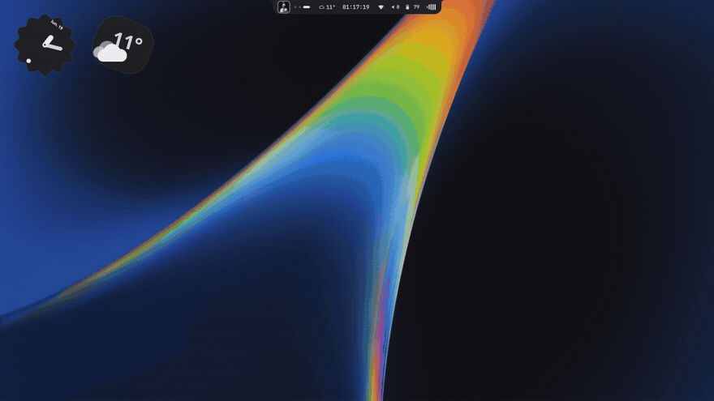
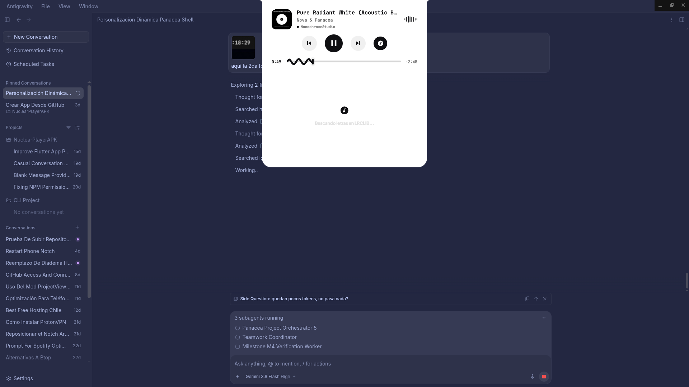
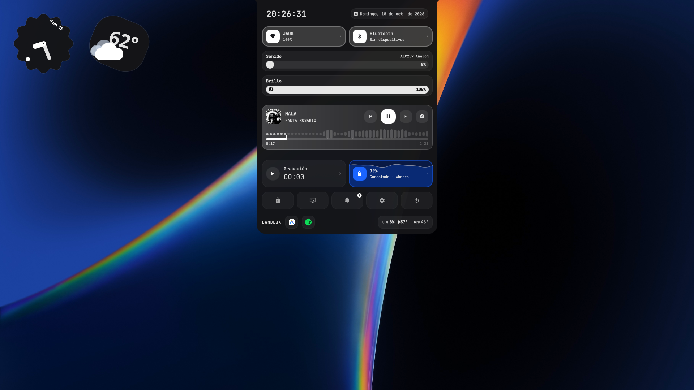
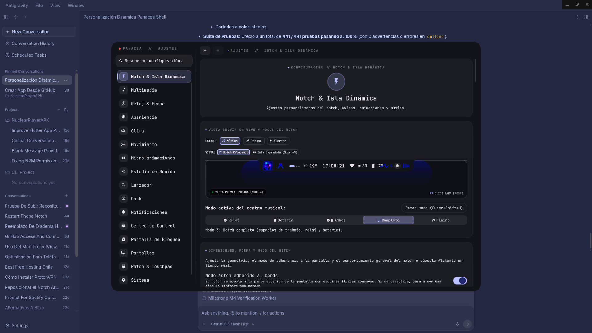
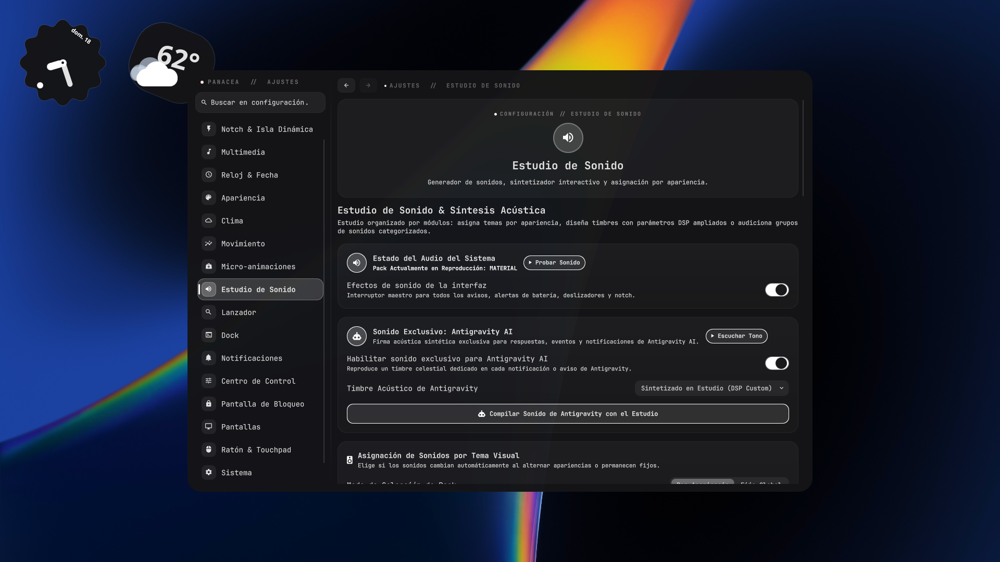

<div align="center">

# 🌌 Panacea_novZ

**Suite de interfaz de escritorio, Notch Dinámico y Centro de Control para Wayland & Hyprland**  
*Bifurcación, optimización, expansión y rediseño profundo del proyecto original [Panacea](https://github.com/EnsixD/Panacea) creado por [EnsixD](https://github.com/EnsixD)*

[](https://archlinux.org/)
[](https://ubuntu.com/)
[](https://debian.org/)
[](https://getfedora.org/)
<br/>
[](https://hyprland.org/)
[](https://quickshell.outfoxxed.me/)
[](https://fishshell.com/)
[](LICENSE)
<br/>
[](https://github.com/EnsixD/Panacea)

<br/>

> [!IMPORTANT]
> ### 📢 Reconocimiento, Atribución & "Vibecoding"
> **Quiero dejar expresamente claro que este proyecto NO es una creación aislada desde cero por mí (NovZ).**
> 
> Este repositorio es una versión perfeccionada, expandida y adaptada del proyecto original **[Panacea](https://github.com/EnsixD/Panacea)**, cuyo creador y autor conceptual original es **[EnsixD](https://github.com/EnsixD)**. Todo el mérito por la concepción arquitectónica de la barra y el concepto inicial le pertenece a él.
> 
> Todas las optimizaciones visuales, el motor acústico desacoplado, el sistema dinámico de letras sincronizadas (SpicyLyrics 60 FPS / 50ms), el rediseño Dark Unibody, la localización trilingüe en tiempo real, el gestor de instalación limpia y las correcciones de estabilidad universal fueron **completamente vibecodeadas por NovZ** (*vibecoding / vibecodeado por NovZ*), llevando la experiencia a un estándar cinematográfico, fluido y libre de asperezas.

> [!TIP]
> **🌐 Soporte Multilingüe en Tiempo Real**: Panacea_novZ cuenta con localización trilingüe completa (**Español**, **English** y **Русский**) con más de 1,500 claves traducidas y cambio instantáneo reactivo sin necesidad de reiniciar la sesión, además de selector visual de distribución y atajos de teclado desde el menú.

</div>

---

## 📸 Galería Visual

<div align="center">

### 🎬 Demostración en Vivo (Tour Completo de la Suite)
*Recorrido fluido en tiempo real: Isla Dinámica contraída → Cápsula Musical con SpicyLyrics sincronizado → Centro de Control Unibody (`Super + Z`) → Menú Rápido Wi-Fi → Estudio Completo de Configuración (`Super + I`) explorando Notch e Isla Dinámica, Estudio de Sonido Acústico y Apariencia.*



<br/>

### 1. Notch Dinámico & Barra de Estado (Modo Dark Unibody)
*Notch dinámico e isla interactiva inspirada en la dinámica visual de la isla flotante (tipo iPhone), integrada al centro superior de la pantalla con onda acústica reactiva a la música en tiempo real.*


<br/>

### 2. Cápsula Musical Expandida & SpicyLyrics (`Super + M`)
*Despliegue a 60 FPS con sincronización temporal (~50 ms de anticipación) y predicción acústica de márgenes para que ninguna palabra se quiebre de renglón al agrandarse la fuente en tiempo real.*



<br/>

### 3. Centro de Control Unificado (`Super + Z`)
*Chasis unibody pulido (`#141218`) con esquinas redondeadas continuas, sliders hápticos, carátulas HD y selección rápida de dispositivos sin bordes residuales.*



<br/>

### 4. Estudio de Personalización del Notch
*Ajustes en vivo de geometría (anchos, radios, márgenes, padding, resplandor ambiental) con simulación interactiva 1:1 en tiempo real.*



<br/>

### 5. Estudio Acústico de Sonido Sintetizado (`sound_engine.py`)
*Configuración matemáticamente desacoplada de Ancho Estéreo (Spatial Stereo Width) y Cola de Reverb (Room Decay Reverb) con packs hápticos.*



</div>

---

## 🔍 Novedades y Características Exclusivas de Panacea_novZ

A continuación se detalla el compendio de novedades, refactorizaciones y correcciones desarrolladas y calibradas en **Panacea_novZ**:

### 1. 🏝️ Notch Dinámico e Isla Interactiva (Dynamic Island)
- **Chasis Dark Unibody Continuo**: Acabado negro satinado continuo (`#141218`) con curvas hiperelípticas suaves y eliminación total de recuadros o fondos desalineados.
- **Resplandor Ambiental Reactivo (*Ambient Glow*)**: Sistema de halo atmosférico configurable en intensidad (5% a 100%) y radio de dispersión (20px a 160px) que pulsa con la música.
- **Hover Peek Inteligente**: Muestra de inmediato el título y glifo de la ventana actualmente enfocada al pasar el puntero por el notch contraído.
- **Aviso Háptico de Portapapeles (*Clipboard Flash*)**: Destello dinámico en la cápsula cada vez que se copia un elemento al buffer del sistema.
- **Aura Reactiva de Audio (*Audio Ripple*)**: Pulsaciones sutiles detrás del notch en reproducción activa sin interferir con la barra de tareas.
- **Indicador Dinámico de Batería**: Animación de rayo fluido al conectar el cargador y colorimetría dinámica por estado de energía.

### 2. 🎤 SpicyLyrics: Motor Cinemático de Letras a 60 FPS
- **Eliminación Total del "Efecto Punto Seguido"**: Predicción elástica de márgenes y saltos de línea para que las palabras no salten bruscamente de renglón al agrandarse la fuente en tiempo real.
- **Anticipación Acústica Milimétrica (~50 ms)**: Adelanto de fotograma calibrado para que el resplandor de la frase coincida exactamente con la voz del cantante.
- **Sincronización BPM y Detección de Tempo (BPM Sync)**: Botón flotante accesible universalmente en la cabecera de SpicyLyrics y directamente en los controles de reproducción de la cápsula (`Super + M`) y centro de control (`Super + Z`). Calcula el BPM y alinea versos con el compás musical (*downbeat*), con micro-ajustes de $\pm 10\text{ ms}$.
- **Backend LRCLIB Robusto**: Búsqueda en 4 niveles (coincidencia estricta, limpieza de remasters/tags, búsqueda difusa y fallback instrumental).
- **Caché Local Atómico**: Almacenamiento instantáneo en `~/.cache/panacea/lyrics/` con hashes SHA-256.

### 3. 🎵 Cápsula Musical Expandida (`Super + M`)
- **Modo Blanco y Negro Radiante**: Si la portada es monocromática o en escala de grises, el visualizador de ondas conmuta automáticamente a blanco puro radiante (`#ffffff`), evitando tonalidades opacas y manteniendo una estética premium.
- **Transiciones de Altura Suaves**: Redimensionamiento dinámico entre modo control estándar y modo SpicyLyrics con físicas desacopladas.

### 4. 🎛️ Centro de Control Unificado Perfeccionado (`Super + Z`)
- **Erradicación de Artefactos de Esquina**: Chasis satinado sin recuadros residuales detrás de las carátulas multimedia.
- **Sliders Hápticos Continuos**: Deslizadores táctiles fluidos para volumen maestro y brillo de pantalla.
- **Selector Rápido de Dispositivos PipeWire**: Interfaz directa para conmutar entre altavoces, auriculares y salidas auxiliares con un solo clic.

### 5. 🔊 Estudio de Sonido Acústico Sintetizado (`sound_engine.py`)
- **Desacoplamiento Matemático Estricto**: Independencia completa entre *Spatial Stereo Width* (efecto Haas / Mid-Side) y *Room Decay Reverb*. Variar el ancho no altera la duración del buffer, y variar el reverb no distorsiona el balance de canales.
- **Síntesis Procedural a 48 kHz / 16-Bit**: Generación en tiempo real de tonos armónicos (`marimba`, `glass`, `fm`, `bit`, `bubble`) y pops hápticos sin archivos comprimidos de baja calidad.
- **7 Soundpacks Integrados**: `custom`, `nothing`, `material`, `zen`, `cyber`, `retro` y `bubble`.

### 6. 🌐 Localización Trilingüe en Tiempo Real & Selector de Teclado
- **Español, English y Русский**: Traducción completa y sin fugas idiomáticas en todos los paneles, widgets, centros de control y ajustes del sistema.
- **Cambio Reactivo sin Reiniciar**: La interfaz conmuta el idioma en milisegundos mediante señales dinámicas en memoria sin necesidad de reiniciar Quickshell ni Hyprland.
- **Configurador de Teclado desde el Menú (`SetInput.qml`)**: Selector visual de distribuciones (`Latam`, `España`, `US`, `Ruso`, combinados) y atajos de conmutación rápida (`Alt+Shift`, `Super+Space`) con aplicación en vivo vía `hyprctl`.

### 7. 🚀 Ventana de Bienvenida & Detección de Primera Instalación
- **Pantalla de Bienvenida Cinemática (`WelcomeView.qml`)**: Al instalar por primera vez o restablecer el sistema, despliega automáticamente una tarjeta interactiva con animación suave que presenta las modificaciones y características más destacadas.
- **Acceso Permanente**: Se puede volver a abrir en cualquier momento desde **Ajustes → Sistema** (*"Ver Bienvenida y Novedades"*) o mediante el comando IPC `qs -c ~/.config/panacea ipc call pill welcome`.

### 8. 🔄 Actualizador Conectado a nov4z & Reinstalación Limpia con Cooldown
- **Actualizador Oficial nov4z**: Comprueba y descarga actualizaciones directamente desde [`nov4z/Panacea_novZ`](https://github.com/nov4z/Panacea_novZ), mostrando con precisión la versión y el commit instalado (`Panacea 1.0.14-novz · compilación <hash>`).
- **Reinstalación Limpia desde Cero con Doble Confirmación**: Botón dedicado al lado de "Comprobar versiones" con cuenta regresiva obligatoria de **5 segundos por cada confirmación**.
- **Limpieza Completa y Rollback Atómico**: Limpia la configuración, la caché de bytecode compilado (`~/.cache/quickshell/qmlcache`), canalizaciones de shaders y temporales. Si ocurre un fallo durante la descarga o compilación, el sistema restaura de forma atómica el estado anterior para no romper tu sesión.
- **Detección de Estado Post-Reinstalación**: Al iniciar tras reinstalar desde el menú, la shell notifica si la instalación concluyó con éxito (banner verde + `voice_done`) o si requirió restaurar el respaldo (aviso crítico + `lowbatt`).

### 9. 🖥️ Widgets de Escritorio Nothing OS & Universalidad de Hardware
- **Widgets Dinámicos (`WidgetsView.qml`, `WeatherDetailsView.qml`, `CalendarView.qml`)**: Reloj Nothing OS, clima multilínea sin colisiones tipográficas, calendario interactivo y medidores de sistema independientes.
- **Hardware Universal**: Adaptado para cualquier laptop o PC de escritorio (no solo Lenovo LOQ), con monitores de hardware precisos (disco, carga, procesos) y fallbacks limpios.
- **Solución al Bug de Caída de Volumen en Spotify**: Regla de configuración específica para `pipewire-pulse` que elimina la bajada de volumen automática al 13% en Spotify.

---

## 🚀 Instalación Rápida

### Opción 1: Asistente Interactivo de Un Solo Comando

Ejecuta el siguiente comando en tu terminal:

```bash
curl -sSL https://raw.githubusercontent.com/nov4z/Panacea_novZ/main/install.sh | bash
```

> [!TIP]
> Si prefieres una instalación automática desatendida sin confirmaciones:
> ```bash
> curl -sSL https://raw.githubusercontent.com/nov4z/Panacea_novZ/main/install.sh | bash -s -- -y
> ```

---

### Opción 2: Instalación Manual mediante Git

1. **Clona el repositorio:**
   ```bash
   git clone https://github.com/nov4z/Panacea_novZ.git
   cd Panacea_novZ
   ```

2. **Ejecuta el instalador:**
   ```bash
   chmod +x install.sh
   ./install.sh
   ```

El instalador se encargará de:
1. Comprobar e instalar dependencias del sistema vía gestores de paquetes (`pacman`, `yay`, `paru`, `apt`, `dnf`).
2. Crear un respaldo fechado de cualquier configuración previa en `~/.config/panacea.backup_<fecha>`.
3. Sincronizar y enlazar todos los componentes QML, scripts, temas y soundpacks en `~/.config/panacea/`.
4. Asignar permisos ejecutables a todos los scripts auxiliares.
5. Aplicar la regla de estabilidad de volumen para Spotify en `pipewire-pulse`.
6. Configurar el arranque automático seguro en tu archivo de configuración de Hyprland (`exec-once = pgrep -x qs >/dev/null || qs -c ~/.config/panacea`).

---

## ⌨️ Atajos de Teclado (Keybindings)

| Combinación de Teclas | Acción | Descripción |
| :--- | :--- | :--- |
| <kbd>SUPER</kbd> + <kbd>M</kbd> | **Cápsula Musical / Dynamic Island** | Expande el reproductor con onda acústica y letras sincronizadas (SpicyLyrics). |
| <kbd>SUPER</kbd> + <kbd>Z</kbd> | **Centro de Control Unibody** | Abre el panel general de volumen, brillo, estado de red y toggles rápidos. |
| <kbd>SUPER</kbd> + <kbd>I</kbd> | **Hub de Configuración** | Abre el panel central de ajustes (Apariencia, Idioma, Teclado, Notch, Sonido, Sistema). |
| <kbd>SUPER</kbd> + <kbd>Space</kbd> | **Lanzador de Aplicaciones** | Despliega el launcher flotante de aplicaciones. |
| <kbd>SUPER</kbd> + <kbd>Shift</kbd> + <kbd>W</kbd> | **Menú Rápido Wi-Fi** | Lista interactiva de redes inalámbricas para conexión inmediata. |
| <kbd>SUPER</kbd> + <kbd>Shift</kbd> + <kbd>B</kbd> | **Menú Rápido Bluetooth** | Administrador de emparejamiento y conexión de auriculares y dispositivos. |
| <kbd>SUPER</kbd> + <kbd>N</kbd> | **Alternar Ocultamiento** | Oculta o muestra el Notch manualmente. |
| <kbd>SUPER</kbd> + <kbd>Shift</kbd> + <kbd>S</kbd> | **Captura de Pantalla** | Selector de área para captura de pantalla rápida. |

---

## 📡 Control por Terminal (IPC Quickshell)

Puedes interactuar con Panacea_novZ desde cualquier terminal o script en tiempo real:

```bash
# Alternar reproductor musical y letras en tiempo real
qs -c ~/.config/panacea ipc call pill music
qs -c ~/.config/panacea ipc call pill toggleLyrics

# Abrir el Centro de Control y Ajustes
qs -c ~/.config/panacea ipc call pill controls
qs -c ~/.config/panacea ipc call pill settings

# Desplegar menús rápidos de red
qs -c ~/.config/panacea ipc call pill wifi
qs -c ~/.config/panacea ipc call pill bluetooth

# Abrir la ventana de Bienvenida y Novedades
qs -c ~/.config/panacea ipc call pill welcome

# Cerrar de forma inteligente cualquier ventana o modal activo
qs -c ~/.config/panacea ipc call pill smartClose
```

---

## 📦 Requisitos del Sistema

- **Sistema Operativo**: Linux (Arch Linux, CachyOS, Fedora, Ubuntu, Debian o cualquier distribución con soporte Wayland).
- **Compositor Wayland**: Hyprland (recomendado) o compositores compatibles con LayerShell.
- **Shell Engine**: `quickshell` (o `quickshell-git`).
- **Librerías Qt6**: `qt6-declarative`, `qt6-multimedia`, `qt6-svg`, `qt6-5compat`, `qt6-wayland`.
- **Audio & Media**: `pipewire`, `wireplumber`, `pipewire-pulse`, `playerctl`, `cava`.
- **Python**: Python >= 3.10 con `numpy` y `scipy`.
- **Tipografía**: `ttf-jetbrains-mono-nerd` y `noto-fonts-emoji`.

---

## 🗂️ Estructura del Proyecto

```text
Panacea_novZ/
├── qml/                          # Componentes QML, Notch Dinámico, Controles e Interfaz
│   ├── shell.qml                 # Contenedor central, Notch Dinámico e IpcHandler
│   ├── ControlsView.qml          # Centro de Control Super + Z Dark Unibody
│   ├── IslandMusicView.qml       # Cápsula musical expandible Super + M
│   ├── SpicyLyricsView.qml       # Visor cinemático de letras en tiempo real (60 FPS / 50ms)
│   ├── WelcomeView.qml           # Ventana de Bienvenida y vitrina de novedades novZ
│   ├── SettingsView.qml          # Hub central de configuración
│   ├── SetAppearance.qml         # Selector de temas (Material You, Nothing OS) e idioma en tiempo real
│   ├── SetInput.qml              # Configurador interactivo de teclado y variantes
│   ├── SetSystem.qml             # Monitor del sistema, autor cards, actualizador y reinstalación
│   ├── SetCustomNotch.qml        # Estudio de personalización y vista previa de Notch
│   ├── SetSounds.qml             # Estudio de audio, efectos y reverberación
│   ├── WidgetsView.qml           # Widgets de escritorio Nothing OS
│   ├── WeatherDetailsView.qml    # Modal detallado del pronóstico del tiempo
│   ├── CalendarView.qml          # Calendario dinámico Nothing OS
│   ├── Themes.js                 # Paletas de color dinámicas y tokens de diseño
│   └── Translations.qml          # Soporte multi-idioma completo (Español, English, Русский)
├── assets/                       # Iconos vectoriales y gráficos de interfaz
├── scripts/                      # Daemons y scripts auxiliares
│   ├── update.sh                 # Actualizador semántico vinculado a nov4z/Panacea_novZ
│   ├── reinstall.sh              # Script de reinstalación limpia desde 0 con rollback de seguridad
│   ├── geninput.sh               # Gestor de distribuciones de teclado en vivo
│   ├── sound_engine.py           # Motor acústico en tiempo real (ancho estéreo + reverb)
│   └── ...                       # Módulos de red, batería, clima y portapapeles
├── screenshots/                  # Galería visual y demos grabadas en alta resolución
├── sounds/                       # Soundpacks acústicos completos
├── tests/                        # Suite automatizada (285 pruebas de integridad en 10 tiers)
│   ├── run_tests.py              # Ejecutor de pruebas unificado
│   └── test_*.py                 # Tests unitarios y de integración
├── install.sh                    # Asistente de instalación automatizado
├── uninstall.sh                  # Script de desinstalación y restauración limpia
├── settings.json.example         # Plantilla predeterminada de configuración
└── LICENSE                       # Licencia MIT de software libre
```

---

## 🧪 Pruebas Automatizadas e Integridad

Panacea_novZ cuenta con una rigurosa suite de pruebas automatizadas que cubren 10 niveles (*tiers*) de arquitectura:

```bash
python3 tests/run_tests.py
```

- **Tier 1**: Sintaxis y validación de gramática QML.
- **Tier 2**: Integridad y cobertura de localización (1,521+ claves en ES, EN, RU).
- **Tier 3**: Pruebas acústicas y desacoplamiento matemático del motor de sonido.
- **Tier 4**: Backend y algoritmos de sincronización de SpicyLyrics.
- **Tier 5**: Consistencia de tokens y paletas de color en `Themes.js`.
- **Tier 6**: Permisos, robustez y ejecución segura de scripts en `scripts/`.
- **Tier 7**: Cobertura de atajos de teclado y contratos IPC.
- **Tier 8**: Respeto al estándar XDG y persistencia de configuración.
- **Tier 9**: Contratos de diseño visual Dark Unibody y métricas.
- **Tier 10**: Scripts de actualización, rollback seguro de reinstalación limpia y ciclo de vida de bienvenida.

> **Resultado actual**: `285/285 pruebas aprobadas (100% SUCCESS)` con cero fallos y cero regresiones.

---

## 🔄 Desinstalación o Restauración

Si deseas desinstalar la interfaz o regresar a una copia de seguridad anterior:

```bash
./uninstall.sh
```

El script detectará los respaldos generados previamente durante la instalación y te permitirá restaurarlos limpiamente.

---

## ⚖️ Verificación Legal de Licencia

> [!NOTE]
> Este proyecto es 100% legal y seguro de distribuir. El repositorio base [EnsixD/Panacea](https://github.com/EnsixD/Panacea) está publicado bajo la **Licencia MIT**, la cual autoriza abiertamente el uso, modificación y redistribución de código abierto siempre que se conserve el copyright original, condición que se cumple estrictamente conservando la atribución a EnsixD (2026) e incorporando a NovZ (2026).

---

## 📄 Créditos, Atribuciones y Recursos

Quiero dar el debido crédito y agradecer de corazón a las personas y proyectos que hacen posible esta experiencia:

- **Proyecto Original**: Todo el reconocimiento y respeto a **[EnsixD](https://github.com/EnsixD)** por concebir la idea y crear la base de **[Panacea](https://github.com/EnsixD/Panacea)**. Yo tomé su excelente trabajo como punto de partida y me dediqué a vibecodearlo, rediseñarlo y pulirlo a fondo para llevarlo al siguiente nivel.
- **Modificación y Vibecoding**: NovZ ([@nov4z](https://github.com/nov4z)) — arquitectura visual Dark Unibody, motor acústico procedural desacoplado, sincronización y predicción cinemática de SpicyLyrics, localización trilingüe en tiempo real, ventana de bienvenida, actualizador directo novZ con reinstalación limpia y optimizaciones de rendimiento y estabilidad en Wayland/Hyprland.
- **Licencia de Código**: Publicado bajo licencia abierta **MIT**, en total respeto y apego a los términos del software libre original. Revisa el archivo [LICENSE](LICENSE) para más información.

<br/>

### 🎨 Fondos de Pantalla (Wallpapers)

> Ninguno de los fondos de pantalla incluidos en este repositorio es de mi autoría — cada uno pertenece íntegramente a su autor original, y los empaqueté aquí únicamente para que una instalación limpia tenga algo hermoso que mostrar de inmediato. Si eres el autor de alguno y quieres que sea retirado, abre un issue y lo quitaré sin ningún problema.

- **[matteogini/dotfiles](https://github.com/matteogini/dotfiles)** — `ember_stripes.jpg` y `misty_peaks.jpg`; la personalización (*rice*) original de la cual nació este setup.
- **[HyDE](https://github.com/HyDE-Project/HyDE)** — `spring_bloom.jpg`, de su tema Graphite Mono; de aquí se derivó la paleta en `hypr/palette.conf`.
- **[ilyamiro/shell-wallpapers](https://github.com/ilyamiro/shell-wallpapers)** — la colección de fondos empaquetada en la carpeta `wallpapers/`.

### 🎥 Wallpapers en Video / Live

La reproducción de fondos de video dinámicos se gestiona mediante **[mpvpaper](https://github.com/GhostNaN/mpvpaper)** (no incluye videos pesados preinstalados para mantener la descarga ligera). Puedes colocar tus propios videos en formato `.mp4`, `.webm`, `.mkv` o `.mov` dentro de `~/.config/hypr/wallpaper/live/`, o conseguirlos bajo sus propios términos en comunidades como [DesktopHut](https://www.desktophut.com/), [Wallper](https://wallper.co/), [TuxPapers](https://tuxpapers.com/) o [Papyrus](https://papyrus.co/).

### 🔤 Tipografía, Iconografía y Gráficos

- **Tipografía de la Interfaz**: **[JetBrains Mono Nerd Font](https://www.jetbrains.com/lp/mono/)** (licencia SIL OFL), junto a **[Material Design Icons](https://materialdesignicons.com/)** para cada glifo de los paneles.
- **Logos y Assets**: Los gráficos `assets/logo*.png` fueron dibujados para este proyecto y comparten la misma licencia del código.

### ⚙️ Sobre Hombros de Gigantes (Tecnologías Base)

Esta suite fue construida sobre el trabajo de fantásticos proyectos de la comunidad:  
[Hyprland](https://hyprland.org/) · [Quickshell](https://quickshell.outfoxxed.me/) · [cava](https://github.com/karlstav/cava) · [cliphist](https://github.com/sentriz/cliphist) · [hyprpaper](https://github.com/hyprwm/hyprpaper) / [hyprsunset](https://github.com/hyprwm/hyprsunset) · [wf-recorder](https://github.com/ammen99/wf-recorder) · [fish](https://fishshell.com/)

---

<div align="center">
  <sub>Basado con admiración en el trabajo original de <b><a href="https://github.com/EnsixD/Panacea">EnsixD</a></b> • Edición vibecodeada por NovZ (<a href="https://github.com/nov4z/Panacea_novZ">nov4z/Panacea_novZ</a>)</sub>
</div>
